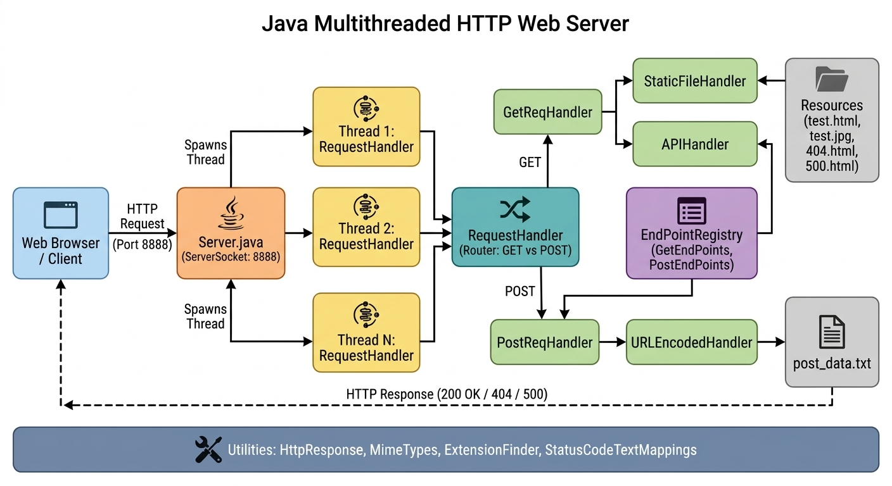

# Multithreaded HTTP/1.1 Web Server in Java


A lightweight, high-performance, custom multithreaded HTTP/1.1 web server built completely from scratch in pure Java using `ServerSocket` and concurrent `Thread` handling—without relying on heavy external frameworks like Spring Boot or Tomcat. 

This project demonstrates low-level socket programming, raw HTTP request parsing, dynamic endpoint routing, static asset delivery, and multi-stage Docker containerization.

---

## System Architecture


### How a Request Flows Through the Server:
1. **Connection Acceptance:** `Server.java` listens continuously on port `8888` using a `ServerSocket`.
2. **Thread Spawning:** Every incoming client connection (`Socket`) is immediately handed off to a dedicated `RequestHandler` thread, allowing the server to process multiple users simultaneously without blocking.
3. **Request Parsing & Routing:** `RequestHandler` parses the raw HTTP request headers, method (`GET` or `POST`), and target URI, then forwards it to the appropriate handler.
4. **Execution:**
   - **GET Requests:** `GetReqHandler` checks if the URI matches a registered API endpoint (`APIHandler`) or a static file (`StaticFileHandler`) inside `src/main/resources`.
   - **POST Requests:** `PostReqHandler` and `URLEncodedHandler` parse incoming form payloads, decode URL-encoded parameters, and persist the data into `post_data.txt`.
5. **Response Generation:** `HttpResponse`, `MimeTypes`, and `StatusCodeTextMappings` construct a valid HTTP/1.1 response with proper headers, content types, and status codes (`200 OK`, `404 Not Found`, `500 Internal Server Error`).

---

## Key Features
- **Concurrent Multithreading:** Handles multiple simultaneous HTTP client connections cleanly using Java Threads.
- **Custom HTTP/1.1 Parser:** Manually parses HTTP request lines, headers, query parameters, and request bodies.
- **Static File Serving:** Automatically detects file extensions and maps accurate MIME types to serve HTML pages (`test.html`), images (`test.jpg`), and custom error pages (`404.html`, `500.html`).
- **Dynamic Endpoint Registry:** Centralized `EndPointRegistry` architecture to manage custom `GET` and `POST` routes cleanly.
- **Form Data Persistence:** Supports `application/x-www-form-urlencoded` form submissions and writes decoded records to local storage (`post_data.txt`).
- **Multi-Stage Docker Support:** Optimized `Dockerfile` that compiles the fat JAR via Maven and runs it inside a lightweight Alpine JRE container.
- **Automated Unit Testing:** Includes JUnit test suites (`HttpServerGetTest`) to validate endpoints and HTTP status responses.

---

## Tech Stack & Dependencies
- **Core Language:** Java 17 (LTS)
- **Networking & Concurrency:** `java.net.ServerSocket`, `java.net.Socket`, `java.lang.Thread`
- **Build & Packaging:** Apache Maven (`maven-shade-plugin` for executable fat JAR)
- **JSON Processing:** Google Gson `2.13.1`
- **Testing Frameworks:** JUnit 4 & JUnit 5 (Jupiter)
- **Containerization:** Docker (Multi-stage build with Eclipse Temurin 17)

---

## Project Directory Structure
```text
http-web-server/
 ├── src/
 │    ├── main/
 │    │    ├── java/webserver/
 │    │    │    ├── api/
 │    │    │    │    ├── EndPointRegistry.java      # Central registry for API routes
 │    │    │    │    ├── GetEndPoints.java          # Defines custom GET endpoints
 │    │    │    │    └── PostEndPoints.java         # Defines custom POST endpoints
 │    │    │    ├── handler/
 │    │    │    │    ├── getrequests/
 │    │    │    │    │    ├── APIHandler.java       # Executes registered GET APIs
 │    │    │    │    │    ├── GetReqHandler.java    # Routes GET requests (API vs Static)
 │    │    │    │    │    └── StaticFileHandler.java# Reads and serves static files
 │    │    │    │    ├── postrequets/
 │    │    │    │    │    ├── PostReqHandler.java   # Routes POST requests
 │    │    │    │    │    └── URLEncodedHandler.java# Parses & saves form submissions
 │    │    │    │    └── RequestHandler.java        # Multithreaded client socket handler
 │    │    │    ├── util/
 │    │    │    │    ├── ExtensionFinder.java       # Extracts file extensions
 │    │    │    │    ├── HttpResponse.java          # Builds raw HTTP/1.1 responses
 │    │    │    │    ├── MimeTypes.java             # Maps extensions to Content-Types
 │    │    │    │    └── StatusCodeTextMappings.java# Maps HTTP codes (200, 404, 500)
 │    │    │    └── Server.java                     # Main entry point (Port 8888)
 │    │    └── resources/
 │    │         ├── errors/
 │    │         │    ├── 404.html                   # Custom Not Found error page
 │    │         │    └── 500.html                   # Custom Server Error page
 │    │         ├── test.html                       # Main landing page
 │    │         ├── test.jpg                        # Sample static image asset
 │    │         └── url-encoded-form.html           # HTML form for testing POST requests
 │    └── test/java/
 │         └── HttpServerGetTest.java               # Automated JUnit integration tests
 ├── Dockerfile                                     # Multi-stage Docker build configuration
 ├── pom.xml                                        # Maven project configuration
 ├── post_data.txt                                  # Stores submitted POST form data
 ├── Architecture.png                               # System architecture diagram
 └── README.md                                      # Project documentation
```

---

## Available Routes & Testing URLs
Once the server is running on port `8888`, you can test the following endpoints in your browser:

| Method | Endpoint / Path | Description |
| :--- | :--- | :--- |
| `GET` | `/test.html` | Serves the main landing page |
| `GET` | `/url-encoded-form.html` | Opens the interactive HTML form for POST testing |
| `GET` | `/test.jpg` | Serves a static JPEG image with proper image MIME headers |
| `POST` | `/submit` *(or configured POST route)* | Accepts URL-encoded form data and saves it to `post_data.txt` |
| `GET` | `/non-existent-page` | Triggers the custom `404.html` error page |

---

## Getting Started (Local Setup)

### Prerequisites
- **Java Development Kit (JDK) 17** or higher
- **Apache Maven 3.8+** (or IntelliJ IDEA bundled Maven)
- **Git**

### Step-by-Step Installation
1. **Clone the repository:**
   ```bash
   git clone https://github.com
   cd http-web-server
   ```
2. **Build the project using Maven:**
   ```bash
   mvn clean package
   ```
3. **Run the server:**
   - **Via IntelliJ IDEA:** Open `src/main/java/webserver/Server.java` and click the green **Run** button.
   - **Via Terminal:**
     ```bash
     java -jar target/mtws-1.0.jar
     ```
4. **Access the server:** Open your browser and navigate to `http://localhost:8888/test.html`.

---

## Running with Docker
You can build and run the entire server inside a lightweight container without installing Maven locally:

1. **Build the Docker image:**
   ```bash
   docker build -t java-multithreaded-webserver .
   ```
2. **Run the container in detached mode:**
   ```bash
   docker run -d -p 8888:8888 --name http-server java-multithreaded-webserver
   ```
3. **Verify logs:**
   ```bash
   docker logs -f http-server
   ```

---

## Running Automated Tests
To execute the JUnit test suite (`HttpServerGetTest`):
```bash
mvn test
```

---

## License
This project is open-source and available under the [MIT License](LICENSE).
